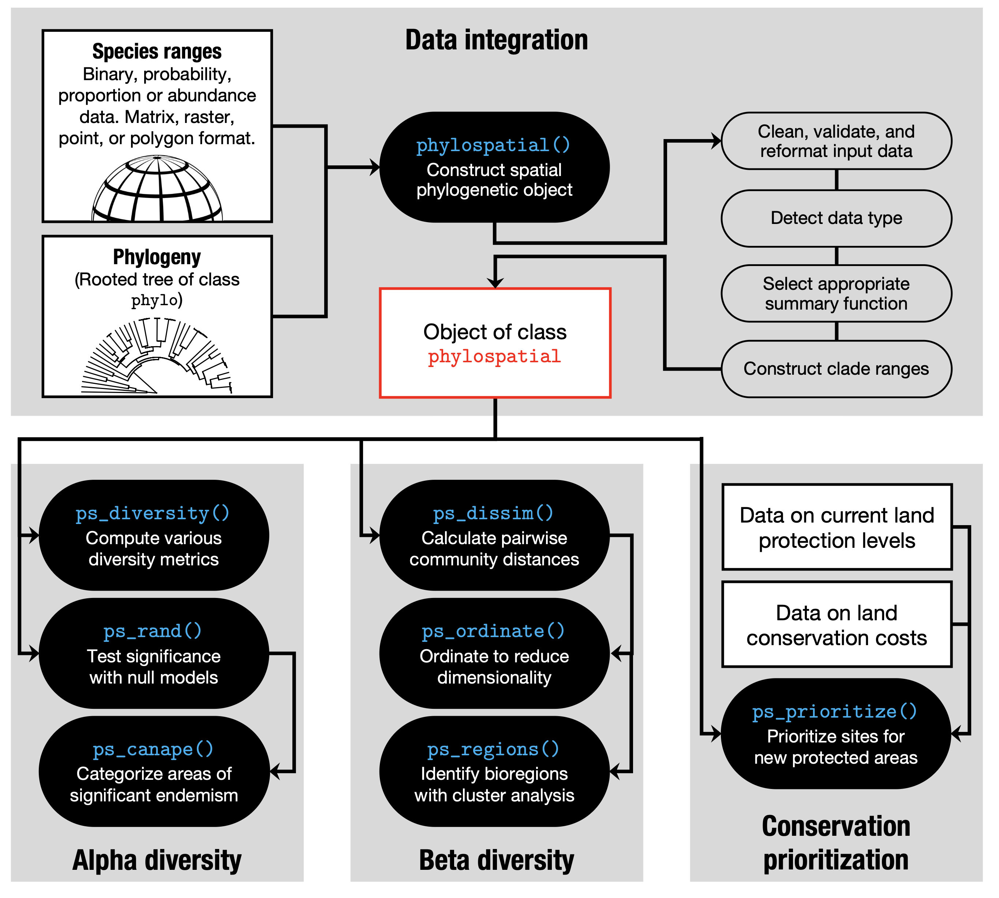
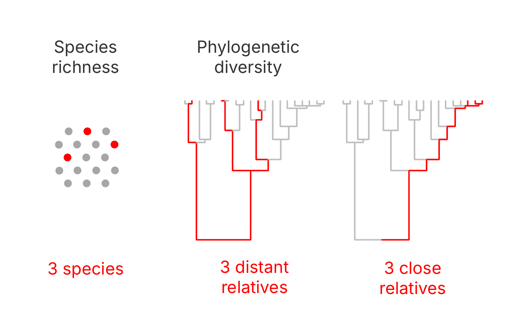
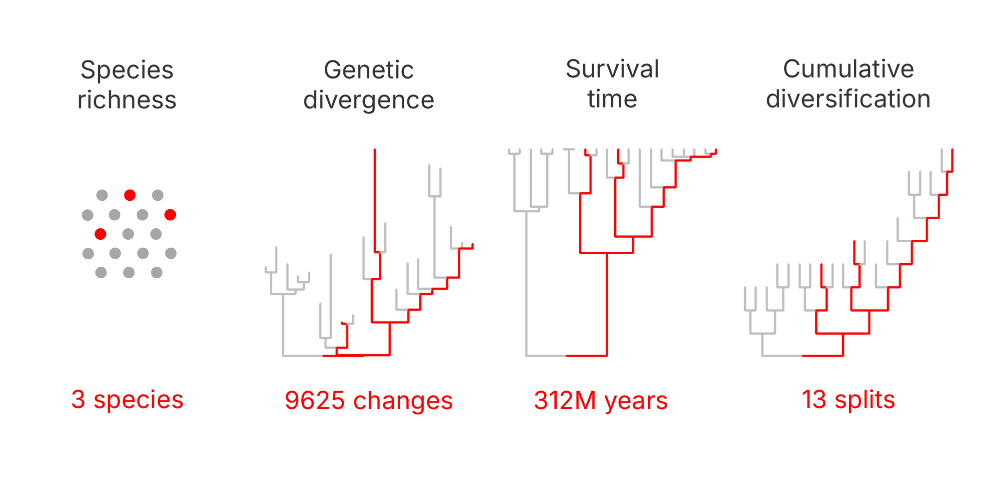
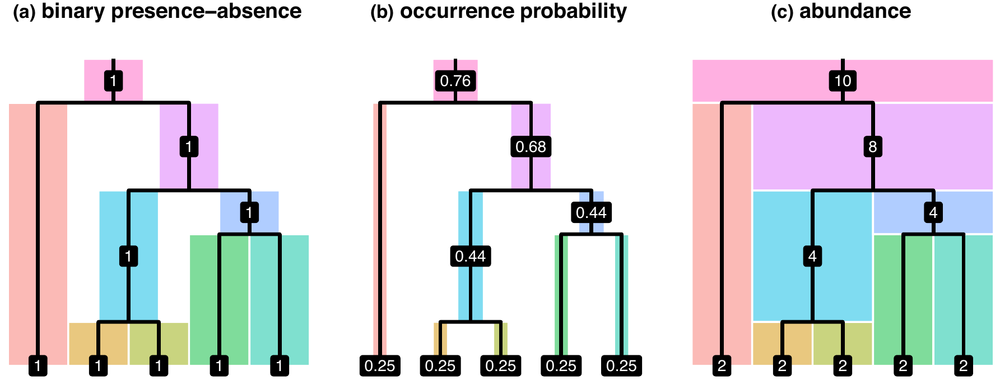
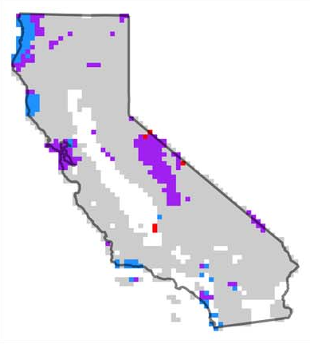
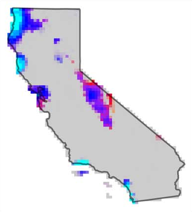
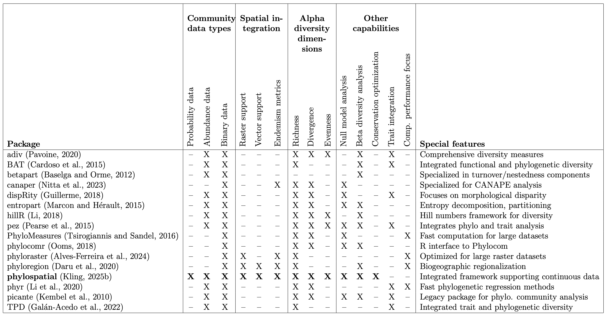
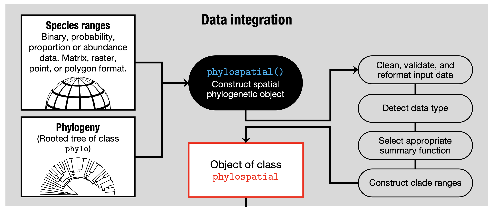
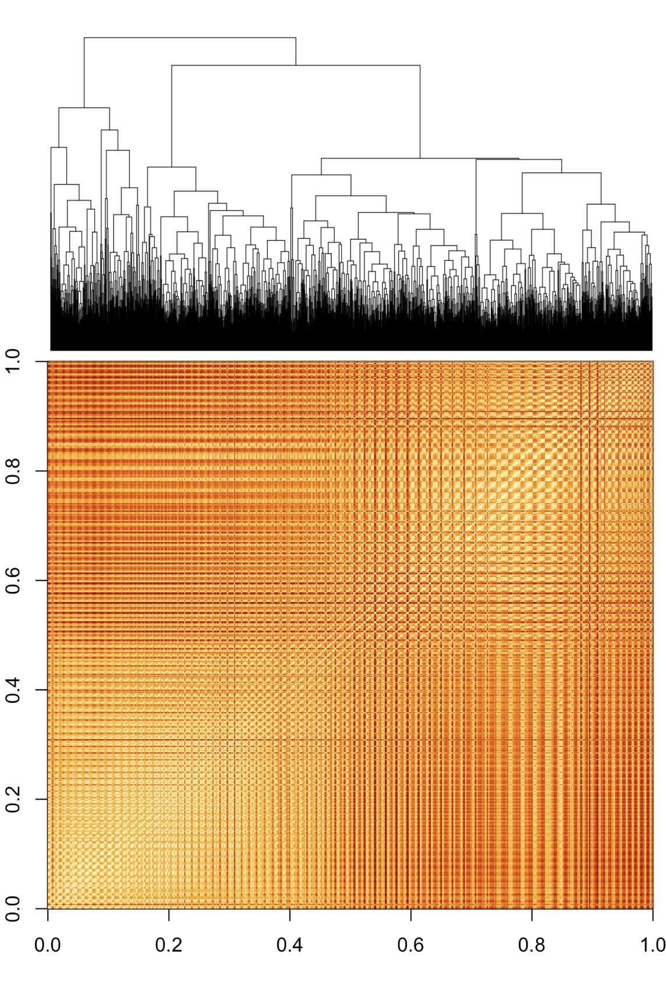

```{r}
#| label: setup
#| include: false
library(phylospatial)
library(terra)
library(ggplot2)
library(tidyterra)
library(patchwork)
sf::sf_proj_network(FALSE)  # use local PROJ data only

# the dataset used throughout
ps   <- moss()
init <- moss(data = "protection")
cost <- 1 + log1p(moss(data = "popdens"))

# plotting helpers, so the code on the slides stays about the analysis
theme_set(theme_minimal(base_size = 15))
# larger text for base-graphics plots, in chunks with `bigtext: true`
knitr::knit_hooks$set(bigtext = function(before, options, envir) {
      if (before) par(cex = 1.2, cex.axis = 1.05, cex.lab = 1.05, cex.main = 1.05)
})
no_axes <- theme(axis.text = element_blank())   # keep graticules, drop lat/long labels

# continuous values (viridis); multi-layer rasters are faceted by layer
map_cont <- function(r, fill = NULL, ...) {
      p <- ggplot() + geom_spatraster(data = r) +
            scale_fill_viridis_c(na.value = NA, ...) + labs(fill = fill)
      if (nlyr(r) > 1) p <- p + facet_wrap(~lyr)
      p + no_axes
}

# null-model quantiles: diverging purple-gray-green on a logit scale
map_quantile <- function(r, fill = "null\nquantile") {
      p <- ggplot() + geom_spatraster(data = clamp(r, 0.001, 0.999)) +
            scale_fill_gradientn(
                  colors = c("darkorchid4", "orchid3", "gray90", "limegreen", "darkgreen"),
                  trans = "logit", limits = c(0.00099, 0.99901),
                  breaks = c(0.001, 0.05, 0.5, 0.95, 0.999),
                  labels = c(".001", ".05", ".5", ".95", ".999"),
                  na.value = NA) +
            labs(fill = fill)
      if (nlyr(r) > 1) p <- p + facet_wrap(~lyr)
      p + no_axes
}

# categorical values
map_cat <- function(r, values, fill = NULL) {
      p <- ggplot() + geom_spatraster(data = r) +
            scale_fill_manual(values = values, na.translate = FALSE, na.value = NA) +
            labs(fill = fill)
      if (nlyr(r) > 1) p <- p + facet_wrap(~lyr)
      p + no_axes
}
canape_cols <- c("gray80", "orchid", "darkorchid4", "red", "blue")

# dissimilarity from focal sites, with each panel's focal point marked;
# `pts` has one point per layer, or a single point shared by all layers
map_focal <- function(r, pts) {
      xy <- sf::st_coordinates(sf::st_transform(pts, crs(r)))
      pd <- data.frame(xy, lyr = factor(names(r), levels = names(r)))
      map_cont(r, "dissimilarity", option = "mako", direction = -1, limits = c(0, 1)) +
            geom_point(data = pd, aes(X, Y), shape = 21, fill = "red", color = "white",
                       size = 3.5, stroke = 1) +
            labs(x = NULL, y = NULL)
}

# three-band color
map_rgb <- function(r) ggplot() +
      geom_spatraster_rgb(data = r, max_col_value = 1, interpolate = FALSE) + no_axes

# cached full-length randomization (1000 null communities), shipped with the package
rand_full <- rast(system.file("extdata", "alpha-diversity-rand.tif", package = "phylospatial"))
```

## Follow along

- Download files: <https://github.com/eco4cast/Statistical-Methods-Seminar-Series/tree/main/kling-phylospatial>
- Install packages:

```{r}
#| eval: false
install.packages(c("phylospatial", "nullcat", "ggplot2", "tidyterra", "patchwork",
                   "prioritizr", "highs"))

# ps_dissim_focal() (section 5) needs the development version:
# install.packages("pak"); pak::pak("matthewkling/phylospatial")
```

## Roadmap

::: columns
::: {.column width="35%"}
1. Concepts
2. Data
3. Diversity
4. Significance
5. Turnover
6. Prioritization
:::

::: {.column width="65%"}
{height="760"}
:::
:::

# 1. Concepts

## What is spatial phylogenetics?

::: columns
::: {.column width="45%"}
Mapping the distribution of **evolutionary history** across landscapes, by combining a phylogeny with species distributions.

- Where is evolutionary diversity concentrated?
- Where are old or young lineages restricted?
- How does lineage composition change across space?
- Where should we protect it?
:::

::: {.column width="55%"}
```{r}
#| label: teaser
#| echo: false
#| fig.width: 7
#| fig.height: 6.6
ps_d <- ps_add_dissim(ps)
pri <- ps_prioritize(ps, init = init, cost = cost, progress = FALSE)
(map_cont(ps_diversity(ps, "PE"), "PE") + ggtitle("Concentrated")) +
      (map_cat(ps_canape(rand_full), canape_cols, NULL) + ggtitle("Old vs. young")) +
      (map_rgb(ps_rgb(ps_d, trans = rank)) + ggtitle("Composition")) +
      (ggplot() + geom_spatraster(data = pri) +
            scale_fill_gradientn(colors = viridisLite::viridis(5)[c(1:5, 5)],
                                 trans = "log10", na.value = NA) +
            no_axes + ggtitle("Protect")) +
      plot_layout(ncol = 2) &
      theme(legend.position = "none", plot.title = element_text(hjust = 0.5))
```
:::
:::

## Why measure biodiversity using phylogeny?

{height="720"}


## Why measure biodiversity using phylogeny?

{width="100%"}


## Most phylodiversity metrics are familiar ones, applied to branches

| Species-level | Branch-level |
|---|---|
| Richness: count of species | **PD**: total branch length present |
| Weighted endemism: species weighted by 1 / range size | **PE**: branch length weighted by 1 / range size |


## Common misconceptions

| Misconception | Reality |
|---|---|
| Counting clades as well as species double-counts occurrences | Each branch counts once, weighted by its own length: a clade adds only the history unique to it |
| Clade ranges are reconstructed ancestral ranges | They are where a clade's living descendants occur today |
| High phylogenetic endemism means old lineages | PE mixes branch length and range size; CANAPE separates neo- from paleo-endemism |

## Every clade has a range

A branch occurs wherever any of its descendants occurs.

```{r}
#| label: clade-ranges
#| echo: false
#| fig.width: 7.41
#| fig.height: 3.33
#| out.width: "960px"
# pick a clade whose two daughter lineages have clearly different ranges:
# each daughter covers 15-60% of sites, with as little overlap as possible
cm <- round(ps$comm); e <- ps$tree$edge; nt <- ape::Ntip(ps$tree)
cand <- do.call(rbind, lapply(which(e[, 2] > nt), function(i) {
      k <- which(e[, 1] == e[i, 2])
      if (length(k) != 2) return(NULL)
      a <- cm[, k[1]] > 0; b <- cm[, k[2]] > 0
      data.frame(k1 = k[1], k2 = k[2], pa = mean(a), pb = mean(b),
                 overlap = sum(a & b) / sum(a | b))
}))
cand <- subset(cand, pmin(pa, pb) >= 0.15 & pmax(pa, pb) <= 0.6)
best <- cand[which.min(cand$overlap), ]
# binary ranges (rounded probabilities); the clade is present wherever either daughter is
daughters <- round(ps_get_comm(ps, tips_only = FALSE)[[c(best$k1, best$k2)]])
ranges <- c(daughters, max(daughters))
names(ranges) <- c("daughter lineage A", "daughter lineage B", "their clade")
ggplot() + geom_spatraster(data = as.factor(ranges)) + facet_wrap(~lyr, nrow = 1) +
      scale_fill_manual(values = c("gray88", "#1b7837"), labels = c("absent", "present"),
                        na.translate = FALSE, na.value = NA, name = NULL) +
      no_axes
```


## Ranges don't have to be binary

{width="100%"}

A clade's value comes from its members: present if any are (binary), P = 1 &minus; &prod;(1 &minus; p<sub>i</sub>) (probability), or the sum (abundance).

## Quantitative measures paint richer pictures

::: columns
::: {.column width="50%"}
**Thresholded ranges**

{height="600"}
:::

::: {.column width="50%"}
**Continuous ranges**

{height="600"}
:::
:::

Moss neo- and paleo-endemism (Kling et al. 2026, *Systematic Botany*).

## The phylospatial package

::: columns
::: {.column width="75%"}
Spatial phylogenetic analysis in R, from data to conservation priorities

- **Quantitative data throughout:** binary, probability, or abundance ranges
- **Spatial in and out:** {terra} rasters, {sf} polygons, or plain matrices
- **One object, many analyses:** diversity, null models, turnover, prioritization
- **Builds on** {ape}, {vegan}, {nullcat}, {prioritizr}

On CRAN · Kling (2025) *Methods in Ecology and Evolution*
:::

::: {.column width="25%"}
{width="90%"}
:::
:::

## Other options for PD analyses in R

{height="600"}

Many R packages compute PD across sites (Kling 2025, *MEE*, Table 1)

# 2. Data

## Two ingredients

`phylospatial()` combines a tree and community data into one object, building a range for every branch.

{height="560"}

## A toy dataset in one line

`ps_simulate()` generates a random dataset, useful for learning and testing.

```{r}
#| label: simulate
#| fig.width: 7.41
#| fig.height: 2.07
#| out.width: "960px"
sim <- ps_simulate(n_tips = 20, data_type = "probability")
plot(sim, "comm", taxa = 1:4, nc = 4, axes = FALSE)
```

## From occurrence points to a grid

`ps_grid()` turns occurrence records into an equal-area community grid. Raw records reflect sampling effort; modeled ranges smooth it out.

```{r}
#| label: grid
pts    <- read.csv("data/moss_points.csv")  # species, lon, lat
comm   <- ps_grid(pts)                      # equal-area grid
ps_pts <- phylospatial(comm, ps$tree)
```

::: columns
::: {.column width="50%"}
```{r}
#| label: grid-plot-points
#| echo: false
#| fig.width: 4.5
#| fig.height: 3.5
map_cont(ps_diversity(ps_pts, "TD"), "richness") + ggtitle("From point records")
```
:::

::: {.column width="50%"}
```{r}
#| label: grid-plot-model
#| echo: false
#| fig.width: 4.5
#| fig.height: 3.5
map_cont(ps_diversity(ps, "TD"), "richness") + ggtitle("From modeled probabilities")
```
:::
:::

## Building the moss dataset

443 California moss species: occurrence probabilities from species distribution models on a 30 km grid, plus a phylogeny (Kling et al. 2026, *Systematic Botany*). Both ship with the package; `moss()` is a one-line shortcut for the code below.

::: columns
::: {.column width="62%"}
```{r}
#| label: print-ps
#| message: true
ext  <- system.file("extdata", package = "phylospatial")
comm <- rast(file.path(ext, "moss_comm.tif"))
tree <- ape::read.tree(file.path(ext, "moss_tree.nex"))
ps   <- phylospatial(comm, tree)
ps
```
:::

::: {.column width="38%"}
```{r}
#| label: fan-tree-code
#| eval: false
plot(ps, "tree", type = "fan",
     show.tip.label = FALSE)
```

```{r}
#| label: fan-tree
#| echo: false
#| fig.width: 5
#| fig.height: 3.7
par(mar = c(0, 0, 0, 0))
plot(ps, "tree", type = "fan", show.tip.label = FALSE)
```
:::
:::

## Inside a phylospatial object

```{r}
#| label: ps-structure
str(ps, max.level = 1)
```


# 3. Diversity

## Diversity and endemism metrics

`ps_diversity()` computes various measures of richness, divergence, and regularity, each in phylogenetic and species-level variations (`?ps_diversity` for the full list).

```{r}
#| label: diversity
div <- ps_diversity(ps, metric = c("TD", "PD", "PE"))
```

```{r}
#| label: diversity-all
#| echo: false
#| fig.width: 15
#| fig.height: 5
#| out.width: "1440px"
m_all <- c("TD", "TE", "CD", "CE", "PD", "PE", "ShPD", "ShPE",
           "SiPD", "SiPE", "RPD", "RPE", "MPDT", "VPDT")
d_all <- ps_diversity(ps, metric = m_all)
d_rel <- (d_all - global(d_all, "min", na.rm = TRUE)[, 1]) /
      (global(d_all, "max", na.rm = TRUE)[, 1] - global(d_all, "min", na.rm = TRUE)[, 1])
map_cont(d_rel, "relative\nvalue", option = "inferno") +
      facet_wrap(~lyr, nrow = 2)
```

## Richness: species richness, PD, and PE

```{r}
#| label: diversity-plot
#| echo: false
#| fig.width: 7.41
#| fig.height: 3.33
#| out.width: "960px"
rel <- div / global(div, "max", na.rm = TRUE)[, 1]
names(rel) <- c("Richness (TD)", "Phylogenetic\ndiversity (PD)", "Phylogenetic\nendemism (PE)")
map_cont(rel, "fraction of\nmaximum", option = "inferno")
```

Each map scaled to its maximum. PD closely tracks richness; PE shifts weight toward places where range-restricted lineages concentrate.


## Divergence and regularity

Beyond how *much* evolutionary history a site holds, `ps_diversity()` measures how it's *structured*. **Divergence** (MPD): how distantly related co-occurring lineages are, on average. **Regularity** (VPD): how evenly spaced they are across the tree; low variance means evenly spaced lineages, high means clumped clusters of close relatives.

```{r}
#| label: div-structure
struct <- ps_diversity(ps, metric = c("MPDT", "VPDT"))
```

```{r}
#| label: div-structure-plot
#| echo: false
#| fig.width: 7.4
#| fig.height: 3.7
#| out.width: "1000px"
rel_s <- struct / global(struct, "max", na.rm = TRUE)[, 1]
names(rel_s) <- c("Divergence (MPD)", "(Ir)regularity (VPD)")
map_cont(rel_s, "fraction of\nmaximum", option = "inferno")
```


## Which part of evolutionary history?

Recall that branch lengths can measure divergence, time, or diversification events. Tree scaling functions change which of those, and which part of history, the metrics weigh. Put the result in `ps$tree` and every metric follows.

```{r}
#| label: slice
#| eval: false
tr <- rescale_tree(ps$tree, "tip1")   # root-to-tip height = 1
slice_tree(tr, min = 0.5)             # older half only
slice_tree(tr, max = 0.5)             # recent half only
delta_tree(tr, delta = 0.3)           # emphasize deep branches
delta_tree(tr, delta = 3)             # emphasize recent branches
uniform_tree(tr)                      # every branch counts equally
```

```{r}
#| label: slice-trees
#| echo: false
#| fig.width: 11.85
#| fig.height: 2.96
#| out.width: "1536px"
tr_all <- rescale_tree(ps$tree, "tip1")
# a ~40-tip clade, so the shapes are readable
nt <- ape::Ntip(tr_all)
nsub <- sapply((nt + 1):(nt + tr_all$Nnode), function(n) length(ape::extract.clade(tr_all, n)$tip.label))
node <- ((nt + 1):(nt + tr_all$Nnode))[which.min(abs(nsub - 40))]
sub <- ape::extract.clade(tr_all, node)
sub <- rescale_tree(sub, "tip1")
trees <- list("original" = sub,
              "older half" = slice_tree(sub, min = 0.5),
              "recent half" = slice_tree(sub, max = 0.5),
              "delta = 0.3" = delta_tree(sub, 0.3),
              "delta = 3" = delta_tree(sub, 3),
              "uniform" = uniform_tree(sub))
par(mfrow = c(1, 6), mar = c(0.5, 0.5, 2.5, 0.5))
for (n in names(trees)) {
      plot(trees[[n]], show.tip.label = FALSE, edge.width = 1.5, direction = "upwards")
      title(n, cex.main = 1.8, font.main = 1)
}
```

# 4. Significance

## Is there more PD than expected?

```{r}
#| label: pd-td
#| echo: false
#| fig.width: 5.5
#| fig.height: 4.5
ggplot(as.data.frame(div), aes(TD, PD)) +
      geom_point(alpha = 0.5) +
      labs(x = "Richness (TD)", y = "Phylogenetic diversity (PD)")
```

Raw PD mostly tracks richness. To see more, compare each site to a null expectation.

## Null models test hypotheses

::: columns
::: {.column width="50%"}
1. Randomize the data many times, holding some features fixed
2. Recompute the metric each time
3. Compare observed to the null distribution

**What you hold fixed defines the hypothesis.**
:::

::: {.column width="50%"}
```{r}
#| label: null-dist
#| echo: false
#| cache: true
#| fig.width: 5
#| fig.height: 4
# null PD for every site; show a site whose nulls have real spread and whose
# observed PD sits clearly (about 3 SD) above the null mean
set.seed(2)
null_pd <- replicate(100, values(ps_diversity(
      ps_quantize(ps, method = "curvecat", n_iter = 1e4), "PD"))[, 1])
obs_pd <- values(div$PD)[, 1]
sdv <- apply(null_pd, 1, sd)
z <- (obs_pd - rowMeans(null_pd)) / sdv
ok <- which(is.finite(z) & sdv > median(sdv, na.rm = TRUE))
site <- ok[which.min(abs(z[ok] - 3))]
nulls <- null_pd[site, ]
obs <- obs_pd[site]
rm(null_pd)
```

```{r}
#| label: null-dist-plot
#| echo: false
#| fig.width: 5
#| fig.height: 4
ggplot(data.frame(PD = nulls), aes(PD)) +
      geom_histogram(bins = 15, fill = "gray75", color = "white") +
      geom_vline(xintercept = obs, color = "darkgreen", linewidth = 1.2) +
      annotate("text", x = obs, y = Inf, label = "observed", color = "darkgreen",
               hjust = 1.1, vjust = 1.5, size = 5) +
      annotate("text", x = -Inf, y = Inf, label = "null distribution", color = "gray40",
               hjust = -0.1, vjust = 1.5, size = 5) +
      expand_limits(x = obs) +
      labs(x = "PD at one site", y = "randomized\ncommunities") +
      theme(panel.grid.minor = element_blank())
```
:::
:::

## Different nulls, different questions

| Null model | Holds fixed | Randomizes | Is the pattern unusual given... |
|---|---|---|---|
| `"tip_shuffle"` | every range map | which lineage owns each range | the ranges, ignoring relatedness? |
| `"curvecat"` | site richness, range sizes | which species occur where | richness and range sizes? |
| `"r0cat"` | site richness | occurrences, range sizes | richness alone? |
| `"c0cat"` | range sizes | occurrences, site richness | range sizes alone? |

Matrix algorithms run on binary data (`fun = "nullcat"`) or quantitative data (`fun = "quantize"`); `fun = "nullmodel"` adds {vegan}'s options.

## Randomizing quantitative data

```{r}
#| label: quantize-fig
#| echo: false
#| fig.width: 13
#| fig.height: 4.6
# a small site x species matrix of occurrence probabilities
x <- matrix(c(.9, .6, .3,  0,  0, .2,
              .7, .8,  0, .4,  0,  0,
               0, .2, .9, .7, .1,  0,
              .1,  0, .6,  0, .8, .3,
               0, .4,  0, .2, .7, .9),
            nrow = 5, byrow = TRUE,
            dimnames = list(paste("site", LETTERS[1:5]), paste0("sp", 1:6)))
br  <- c(-1e-9, 1e-9, 0.5, 1)   # strata: absent | low | high
lab <- c("absent", "low", "high")
s1  <- nullcat::stratify(x, breaks = br)
lev <- sort(unique(as.vector(s1)))
xr  <- nullcat::quantize(x, breaks = br, fixed = "row", method = "curvecat",
                         n_iter = 500, seed = 56)
s2  <- nullcat::stratify(xr, breaks = br)
cols <- c(absent = "gray93", low = "#9ecae1", high = "#2171b5")
qtile <- function(vals, str, title, show_vals = TRUE) {
      d <- data.frame(site = factor(rep(rownames(x), ncol(x)), levels = rev(rownames(x))),
                      sp = factor(rep(colnames(x), each = nrow(x)), levels = colnames(x)),
                      v = as.vector(vals),
                      s = factor(lab[match(as.vector(str), lev)], levels = lab))
      tot <- if (show_vals) sprintf("%.1f", rowSums(vals)) else rep("", nrow(x))
      p <- ggplot(d, aes(sp, site)) +
            geom_tile(aes(fill = s), color = "white", linewidth = 1.2) +
            scale_fill_manual(values = cols, drop = FALSE, name = NULL) +
            scale_x_discrete(position = "top") + coord_equal(clip = "off") +
            annotate("text", x = ncol(x) + 0.9, y = nrow(x):1, label = tot,
                     size = 4.5, color = "gray30") +
            annotate("text", x = ncol(x) + 0.9, y = nrow(x) + 0.75,
                     label = if (show_vals) "total" else "", size = 4, color = "gray30") +
            labs(title = title, x = NULL, y = NULL) + theme_minimal(base_size = 15) +
            theme(panel.grid = element_blank(), plot.title = element_text(hjust = 0.5))
      if (show_vals) p <- p +
            geom_text(data = subset(d, v > 0), aes(label = sub("^0", "", sprintf("%.1f", v)),
                                                   color = s == "high"),
                      size = 4.5, show.legend = FALSE) +
            scale_color_manual(values = c(`FALSE` = "gray15", `TRUE` = "white"))
      p
}
no_y <- theme(axis.text.y = element_blank())
gap  <- theme(plot.margin = margin(5, 40, 5, 5))
(qtile(x, s1, "1. Data, binned\ninto strata") + gap) +
      (qtile(xr, s2, "2. Shuffle strata\n(curvecat)", show_vals = FALSE) + no_y + gap) +
      (qtile(xr, s2, "3. Return each site's\nvalues to matching cells") + no_y) +
      plot_layout(nrow = 1, guides = "collect") & theme(legend.position = "bottom")
```

Each site keeps its values; each species keeps its mix of strata. `quantize()` from [{nullcat}](https://matthewkling.github.io/nullcat/)

## How many iterations?

::: columns
::: {.column width="50%"}
Swap-based nulls need enough swaps to forget the original data. `ps_suggest_n_iter()` runs several chains and suggests a burn-in, the minimum `n_iter` per null community.

```{r}
#| label: n-iter-code
#| eval: false
iters <- ps_suggest_n_iter(
  ps, fun = "quantize",
  method = "curvecat", n_iter = 3e5)
```

Real analyses: `n_iter = iters`, `n_rand = 1000`.
:::

::: {.column width="50%"}
```{r}
#| label: n-iter
#| echo: false
#| cache: true
set.seed(1)
tr <- ps_trace(ps, fun = "quantize", method = "curvecat",
               n_iter = 3e5, plot = FALSE)
```

```{r}
#| label: n-iter-plot
#| bigtext: true
#| echo: false
#| fig.height: 4
iters <- nullcat::suggest_n_iter(tr, plot = TRUE)
```
:::
:::

## Running a randomization

::: columns
::: {.column width="50%"}
`ps_rand()` compares each site's metrics with randomized communities, returning a null quantile per site: green = more than expected, purple = less.

```{r}
#| label: rand
set.seed(1)
rand <- ps_rand(
  ps, metric = c("PD", "PE", "CE", "RPE"),
  fun = "quantize", method = "curvecat",
  n_rand = 100, n_iter = 5e4)  # ~30 s
```
:::

::: {.column width="50%"}
```{r}
#| label: rand-plot
#| echo: false
#| fig.width: 7.2
#| fig.height: 7.2
map_quantile(rand$qPD, "PD null\nquantile")
```
:::
:::

## Neo- and paleo-endemism (CANAPE)

::: columns
::: {.column width="50%"}
`ps_canape()` classifies sites as centers of neo-, paleo-, mixed, or super-endemism, from the significance of PE, RPE, and CE in a randomization (Mishler et al. 2014).

```{r}
#| label: canape
canape <- ps_canape(rand)
```

- **Neo-endemism**: concentrations of short, range-restricted branches
- **Paleo-endemism**: concentrations of long, range-restricted branches
- Patterns of where restricted lineages are today, not a direct test of how they got there
:::

::: {.column width="50%"}
```{r}
#| label: canape-plot
#| echo: false
#| fig.width: 7.2
#| fig.height: 7.2
map_cat(canape, canape_cols, NULL) +
      theme(legend.position = "bottom", legend.text = element_text(size = 15))
```
:::
:::

# 5. Turnover

## What does phylogenetic turnover measure?

```{r}
#| label: turnover-concept
#| echo: false
#| fig.width: 14
#| fig.height: 4.8
tr8 <- ape::read.tree(text = "(((a:1,b:1):1,(c:1,d:1):1):2,((e:1,f:1):1,(g:1,h:1):1):2);")
colA <- "#d95f02"; colB <- "#1b9e77"
turnover_tree <- function(A, B, title) {
      m <- rbind(A = as.numeric(tr8$tip.label %in% A), B = as.numeric(tr8$tip.label %in% B))
      colnames(m) <- tr8$tip.label
      p  <- phylospatial(m, tr8, check = FALSE)
      inA <- p$comm[1, ] > 0; inB <- p$comm[2, ] > 0
      ecol <- ifelse(inA & inB, "black", ifelse(inA, colA, ifelse(inB, colB, "gray85")))
      tl <- p$tree$tip.label
      tcol <- ifelse(tl %in% A & tl %in% B, "black", ifelse(tl %in% A, colA, ifelse(tl %in% B, colB, "gray85")))
      plot(p$tree, edge.color = ecol, edge.width = 6, show.tip.label = FALSE,
           direction = "downwards", no.margin = FALSE)
      ape::tiplabels(pch = 19, col = tcol, cex = 3.2)
      title(main = title, cex.main = 1.7, font.main = 1, line = 0)
      mtext(sprintf("species dissimilarity = %.2f\nphylogenetic dissimilarity = %.2f",
                    ps_dissim(p, tips_only = TRUE)[1], ps_dissim(p)[1]),
            side = 1, line = 2.6, cex = 1.3)
}
par(mfrow = c(1, 4), mar = c(5, 1, 3.5, 1))
turnover_tree(c("a","c"), c("b","d"), "No shared species,\nclose relatives")
turnover_tree(c("a","c"), c("e","g"), "No shared species,\ndistant relatives")
turnover_tree(c("a","b","c"), c("a","b","d"), "Some shared species")
plot.new()
legend("left", legend = c("only at site A", "only at site B", "at both sites", "at neither"),
       col = c(colA, colB, "black", "gray85"), lwd = 6, pch = 19, pt.cex = 2.5,
       bty = "n", cex = 1.6, y.intersp = 1.5)
```

Phylogenetic dissimilarity is the share of branch length **not** shared by two sites. Species turnover treats every pair of different species as equally different; phylogenetic turnover is low when sites hold close relatives, and high when they hold distant lineages.

## Dissimilarity from a focal site

`ps_dissim_focal()` maps how different every other site is from a focal location. Here, sites in the Sierra Nevada and the Mojave Desert.

```{r}
#| label: focal
focal <- sf::st_as_sf(data.frame(lon = c(-119.6, -116), lat = c(37.8, 34.6)),
                      coords = c("lon", "lat"), crs = 4326)
d_focal <- ps_dissim_focal(ps, focal)
```

```{r}
#| label: focal-plot
#| echo: false
#| fig.width: 8.15
#| fig.height: 4.07
#| fig-align: center
#| out.width: "1056px"
names(d_focal) <- c("Sierra Nevada", "Mojave Desert")
map_focal(d_focal, focal)
```

## Many kinds of dissimilarity

A wide range of dissimilarity measures are available, including any {vegan} index and the turnover and nestedness components of Sorensen (Baselga & Orme 2012).

```{r}
#| label: dissim-options
#| eval: false
sierra <- focal[1, ]
ps_dissim_focal(ps, sierra, method = "sorensen")             # default
ps_dissim_focal(ps, sierra, method = "sorensen_turnover")    # lineage replacement
ps_dissim_focal(ps, sierra, method = "sorensen_nestedness")  # richness differences
ps_dissim_focal(ps, sierra, endemism = TRUE)    # weight range-restricted branches
ps_dissim_focal(ps, sierra, normalize = TRUE)   # proportional composition
ps_dissim_focal(ps, sierra, tips_only = TRUE)   # species only, no tree
```

```{r}
#| label: dissim-focal
#| echo: false
#| fig.width: 11.11
#| fig.height: 2.67
#| out.width: "1440px"
sierra <- focal[1, ]
opts <- list("sorensen"   = list(method = "sorensen"),
             "turnover"   = list(method = "sorensen_turnover"),
             "nestedness" = list(method = "sorensen_nestedness"),
             "endemism"   = list(endemism = TRUE),
             "normalize"  = list(normalize = TRUE),
             "tips only"  = list(tips_only = TRUE))
dmaps <- rast(lapply(opts, function(o) do.call(ps_dissim_focal, c(list(ps = ps, site = sierra), o))))
names(dmaps) <- names(opts)
map_focal(dmaps, sierra) + facet_wrap(~lyr, nrow = 1)
```

## An asymmetric index

`method = "focal_difference"` is the share of the focal site's branch length missing from each other site. Unlike Sorensen, it ignores lineages the focal site lacks, so it shows where a site's *own* lineages occur. For the lineage-poor desert site, they occur almost everywhere.

```{r}
#| label: focal-difference
mojave <- focal[2, ]
d_mojave <- c(ps_dissim_focal(ps, mojave),
              ps_dissim_focal(ps, mojave, method = "focal_difference"))
```

```{r}
#| label: focal-difference-plot
#| echo: false
#| fig.width: 7.78
#| fig.height: 3.78
#| fig-align: center
#| out.width: "1008px"
names(d_mojave) <- c("sorensen", "focal_difference")
map_focal(d_mojave, mojave)
```

## All pairs of sites

::: columns
::: {.column width="50%"}
`ps_add_dissim()` computes dissimilarity between every pair of sites and stores the site × site matrix in the object, ready for the analyses that follow.

```{r}
#| label: dissim
ps <- ps_add_dissim(ps)  # Sorensen
```
:::

::: {.column width="50%"}
{height="740"}
:::
:::

## Using the dissimilarity matrix

::: columns
::: {.column width="50%"}
`ps$dissim` is an ordinary `dist` object, so any distance-based method applies:

- Mantel tests against geographic or environmental distance
- What drives turnover: GDM ({gdm})
- Group differences: PERMANOVA (`adonis2()`)
- Ordination and color (`ps_ordinate()`, `ps_rgb()`)
- Regionalization (`ps_regions()`)

```{r}
#| label: mantel
geo <- ps_geodist(ps)
mt <- vegan::mantel(ps$dissim, geo)
round(c(mt$statistic, mt$signif), 3)  # r, p
```
:::

::: {.column width="50%"}
```{r}
#| label: decay
#| echo: false
#| fig.width: 5.5
#| fig.height: 4.4
dd <- data.frame(geo = as.vector(geo) / 1000, d = as.vector(ps$dissim))
set.seed(1)
ggplot(dd[sample(nrow(dd), 2e4), ], aes(geo, d)) +
      geom_point(alpha = 0.08, size = 0.6) +
      geom_smooth(method = "gam", color = "#d95f02", se = FALSE) +
      labs(x = "geographic distance (km)", y = "phylogenetic dissimilarity",
           title = "Distance decay")
```
:::
:::

## Ordination

`ps_ordinate()` reduces the dissimilarity matrix to a few axes that capture the main gradients in lineage composition (classical or nonmetric multidimensional scaling, or PCA).

```{r}
#| label: ordinate
ord <- ps_ordinate(ps, method = "cmds", k = 3)
```

```{r}
#| label: ordinate-plot
#| echo: false
#| fig.width: 8.89
#| fig.height: 3.41
#| out.width: "1152px"
names(ord) <- paste("axis", 1:3)
ggplot() + geom_spatraster(data = ord) + facet_wrap(~lyr, nrow = 1) +
      scale_fill_distiller(palette = "PiYG", na.value = NA, name = "score") +
      no_axes
```

## Mapping turnover as color

::: columns
::: {.column width="50%"}
`ps_rgb()` maps three ordination axes to red, green, and blue, so sites with similar colors have similar lineage composition.

```{r}
#| label: rgb
rgb <- ps_rgb(ps, method = "nmds",
              trans = rank)
```
:::

::: {.column width="50%"}
```{r}
#| label: rgb-plot
#| echo: false
#| fig.width: 7.2
#| fig.height: 7.2
map_rgb(rgb)
```
:::
:::

## Phylogenetic regions

::: columns
::: {.column width="50%"}
`ps_regions()` clusters sites into `k` phylogenetic regions; `ps_regions_eval()` compares how well different `k` fit.

```{r}
#| label: regions
regions <- ps_regions(ps, k = 6,
                      method = "average")
```

```{r}
#| label: regions-eval
#| fig.width: 5
#| fig.height: 2.9
ps_regions_eval(ps, k = 1:15,
                method = "average")
```


:::

::: {.column width="50%"}
```{r}
#| label: regions-plot
#| echo: false
#| fig.width: 7.2
#| fig.height: 7.2
reg <- as.factor(regions)
ggplot() + geom_spatraster(data = reg) +
      scale_fill_brewer(palette = "Paired", na.translate = FALSE, na.value = NA) +
      labs(fill = "region") + no_axes
```
:::
:::

# 6. Prioritization

## What is conservation prioritization?

Choosing *where* to add new protection, given limited resources.

- **Complementarity:** a site's value depends on what's already protected and what other chosen sites already cover
- **Efficiency:** maximize biodiversity gained per unit cost
- **Targets or benefits:** aim to protect a set share of each feature's range, or maximize total benefit with diminishing returns

In phylospatial, the "features" are branches of the tree, so priorities favor sites that add evolutionary history not yet represented in protected areas.

## Prioritization inputs

Existing protection (`init`, from 0 to 1) and the relative cost of protecting each site, both on the moss grid (`ext` is the package data folder from earlier).

::: columns
::: {.column width="50%"}
```{r}
#| label: init
init <- rast(file.path(ext,
                       "moss_protection.tif"))
```

```{r}
#| label: inputs-protection
#| echo: false
#| fig.width: 4.5
#| fig.height: 3.6
map_cont(init, "existing\nprotection") + ggtitle("CPAD/CCED protected areas")
```
:::

::: {.column width="50%"}
```{r}
#| label: cost
pop  <- rast(file.path(ext,
                       "moss_popdens.tif"))
cost <- 1 + log1p(pop)
```

```{r}
#| label: inputs-cost
#| echo: false
#| fig.width: 4.5
#| fig.height: 3.6
map_cont(cost, "cost") + ggtitle("1 + log(1 + population density)")
```
:::
:::

## Diminishing returns

::: columns
::: {.column width="50%"}
- A lineage's benefit rises as more of its range is protected
- `lambda` sets how fast the returns diminish
:::

::: {.column width="50%"}
```{r}
#| label: lambda
#| bigtext: true
#| fig.width: 5
#| fig.height: 5
plot_lambda()
```
:::
:::

## A priority ranking

::: columns
::: {.column width="50%"}
`ps_prioritize()` ranks every site by its added conservation value, given existing protection, cost, and what earlier picks already protect. Rank 1 = top priority.

```{r}
#| label: prioritize
priority <- ps_prioritize(
  ps, lambda = 1, init = init, cost = cost)
```
:::

::: {.column width="50%"}
```{r}
#| label: prioritize-plot
#| echo: false
#| fig.width: 7.2
#| fig.height: 7.2
ggplot() + geom_spatraster(data = priority) +
      scale_fill_gradientn(colors = viridisLite::viridis(5)[c(1:5, 5)],
                           trans = "log10", na.value = NA) +
      labs(fill = "priority\nrank") + no_axes
```
:::
:::

## How much does each step buy?

::: columns
::: {.column width="50%"}
`ps_performance()` tracks how much of the tree reaches a protection target as sites are added in priority order: here, the fraction of branch length with at least 80% of its range protected.

```{r}
#| label: performance-code
#| eval: false
perf <- ps_performance(ps, priority,
                       target = 0.8)
plot(perf, yvar = "cov80")
```
:::

::: {.column width="50%"}
```{r}
#| label: performance
#| bigtext: true
#| echo: false
#| fig.height: 4.2
perf <- ps_performance(ps, priority, target = 0.8)
plot(perf, yvar = "cov80")
```
:::
:::

## Optimal solutions with {prioritizr}

::: columns
::: {.column width="50%"}
`ps_prioritizr()` builds a {prioritizr} problem in which every branch is a feature with a range-protection target. A solver (e.g., {highs}) then finds the cheapest set of new sites that meets every target, rather than a ranking.

```{r}
#| label: prioritizr-code
#| eval: false
library(prioritizr)
prob <- ps_prioritizr(
  ps, init = init, cost = cost,
  objective = "min_set", target = 0.3)
solution <- solve(prob)
```

- Add any prioritizr constraints, penalties, or solvers
- See the earlier {prioritizr} webinar in this series
:::

::: {.column width="50%"}
```{r}
#| label: prioritizr
#| echo: false
#| fig.width: 7.2
#| fig.height: 7.2
library(prioritizr)
prob <- ps_prioritizr(ps, init = init, cost = cost, objective = "min_set",
                      target = 0.3, spatial = FALSE)
solution <- solve(add_highs_solver(prob, verbose = FALSE))
sol_map <- setValues(rast(ps$spatial[[1]]), ps_expand(ps, solution, spatial = FALSE)[, 1])
sol_map <- as.factor(sol_map)
levels(sol_map) <- data.frame(id = 0:1, solution = c("not selected", "selected"))
map_cat(sol_map, c("gray85", "firebrick"), NULL) +
      theme(legend.position = "bottom", legend.text = element_text(size = 15)) +
      ggtitle(sprintf("Minimum-cost solution: %d sites", sum(solution)))
```
:::
:::

# Wrap-up

## Flexible inputs. One object. Many analyses.

{height="760"}

## Thank you!

::: columns
::: {.column width="65%"}
- Package website and vignettes: <https://matthewkling.github.io/phylospatial/>
- Code and issues: <https://github.com/matthewkling/phylospatial>
- Kling (2025) *Methods in Ecology and Evolution*: <https://doi.org/10.1111/2041-210X.70056>
- Kling et al. (2026) *Systematic Botany*: <https://doi.org/10.1600/036364426X17703284494638>
- Contact: <matthew.kling@umontana.edu>

**Questions?**
:::

::: {.column width="35%"}
{width="85%"}
:::
:::
